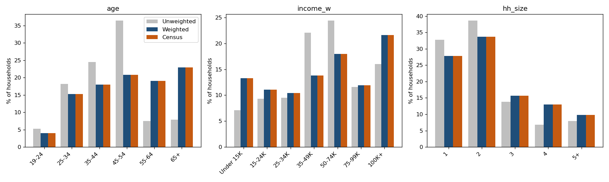

# Consumer Panel Weighting & Projection

**Is a household shopping panel representative, and how do category KPIs change once it is weighted to the population?**

This project follows the workflow of a consumer-panel *measurement science* team: sample and data quality checks → non-response adjustment → raking to census targets → weight trimming and diagnostics → projection to the population with bootstrap confidence intervals.



## Questions
1. How clean is the raw purchase data, and is the panel stable over time?
2. Which households form a reliable *static panel* for projection?
3. Are households that provided demographics different from those that did not (non-response bias)?
4. How far is the sample from the population, and can weighting close the gap?
5. How do department penetration and share of sales change after weighting, and how much precision does weighting cost?

## Data
- **dunnhumby – The Complete Journey** ([Kaggle](https://www.kaggle.com/datasets/frtgnn/dunnhumby-the-complete-journey)): 2,500 households, 102 weeks of grocery purchases (≈2.6M transaction lines, 582 stores, 276,484 baskets), demographics for 801 households. Files used: `transaction_data.csv`, `hh_demographic.csv`, `product.csv`. Raw data are not included in this repository.
- **Population targets:** U.S. Census Bureau, American Community Survey 2012 1-year estimates, U.S. households (115,969,540): age of householder (B25007), household income (B19001), household size (B11016) → `us_household_targets_acs2012.csv`.

## Method
| Step | Tool | What was done |
|---|---|---|
| Data quality | Python (pandas) | Duplicates, zero/negative sales, zero quantity, orphan products, null checks; quality log saved to CSV |
| Panel health | Python, SQL | Active households per week and per 4-week period; ramp-up detection |
| Static panel | Python | Analysis year = weeks 51–102 (13 four-week periods); static = bought in ≥ 12 of 13 periods (sensitivity table 8–13) |
| Non-response | Python (Mann-Whitney U), SQL (`NTILE`) | Spend of households with vs without demographics; response rate by spend quintile |
| Representativeness | Python (chi-square goodness-of-fit) | Sample vs census margins |
| Weighting | Python | Stage A: non-response adjustment with spend-quintile weighting classes. Stage B: raking (iterative proportional fitting) to age × income × household-size margins. Trimming of relative weights to 0.25–5 with re-raking |
| Diagnostics | Python | Kish design effect, effective sample size, weight range |
| Projection | Python, Excel | Weighted penetration, share of sales and spend per household for the top 10 departments; projection to 115.97M households; bootstrap (300 replicates, full re-weighting in each) for 95% confidence intervals |

## Key Findings
- **Clean data, unstable start.** No duplicates, nulls or orphan products; 18,850 lines (0.73%) with zero sales value were removed. Weeks 1–13 had fewer than 80% of the median 1,310 active households (panel ramp-up), so the analysis uses the last 52 weeks.
- **Static panel:** 1,406 of 2,479 active households (56.7%) bought in at least 12 of the 13 periods; in each period 1,367–1,394 of them made a purchase.
- **Strong non-response bias.** Only 730 static households (51.9%) have demographics, and they are heavier shoppers: median annual spend $2,869 vs $1,530 (Mann-Whitney p < 0.0001). The response rate rises from 20.6% in the lightest spend quintile to 74.4% in the heaviest.
- **Non-representative sample.** Householders aged 45–54 are over-represented by +15.6 pp and those 65+ under-represented by −14.9 pp; chi-square p < 0.0001 for age, income and household size.
- **Non-response adjustment removes most of the bias.** Against the known spend of all 1,406 static households ($2,800), unweighted respondents overstate mean spend by +22.7% ($3,436); after the adjustment the gap is +1.3% ($2,835).
- **Raking converged in 9 iterations** and all margins match the census exactly after trimming. Trimming reduced the weight ratio from 61:1 to 21.5:1 and raised the effective sample size from 318 to 342 (design effect 2.13, efficiency 46.9%).
- **Weighting changes the KPIs.** Kiosk-gas penetration falls from 62.9% to 56.4% and nutrition from 75.5% to 70.2%; drug/general merchandise share falls from 12.9% to 12.2%, while produce rises from 7.4% to 7.8%.
- **Projection:** weighted mean annual spend of $2,966 per household, or $344.0bn across 115.97M households ($171.5bn grocery).
- **Precision cost.** Bootstrap 95% CIs are 1.09–1.57 times wider after weighting (e.g. kiosk-gas penetration 56.4% [51.4%, 61.9%]). The unweighted interval for mean spend ($3,272–$3,606) is narrower but sits around a value that is 22.7% above the panel's actual mean: precise but biased.

## Limitations
- The retailer's real trading area is unknown, so national U.S. households are used as an illustrative target population; the projection assumes all households shop like this chain's customers and is not a market-size estimate.
- Census targets are from 2012; the exact years of the dunnhumby data are not published.
- Raking matches margins, not joint distributions (e.g. 65+ × low income).
- The non-response adjustment uses only spend quintiles; other drivers of response are not observed.
- Week 102 is incomplete (data end on day 711).

## SQL Queries (SQLite, run in DBeaver)
- `01_panel_kpis_by_period.sql` – active and static households, baskets and sales per 4-week period
- `02_department_penetration.sql` – department penetration, share of sales and spend per buyer (CTE + window function)
- `03_response_by_spend_quintile.sql` – response rate by spend quintile (`NTILE(5)`)
- `04_sample_profile.sql` – demographic profile with `SUM() OVER (PARTITION BY ...)`; cross-checked against Python

## Repository Structure
```
README.md
01_panel_quality.ipynb            data quality, panel health, static panel, non-response, sample vs census
02_weighting.ipynb                non-response adjustment, raking, trimming, diagnostics
03_projection.ipynb               weighted KPIs, projection, bootstrap confidence intervals
01_panel_kpis_by_period.sql
02_department_penetration.sql
03_response_by_spend_quintile.sql
04_sample_profile.sql
us_household_targets_acs2012.csv  census targets
quality_checks.csv                data quality log
weight_diagnostics.csv            design effect, effective sample size, weight range
margins_check.csv                 margins before/after weighting vs census
projection_results.xlsx           department KPIs, mean spend, projection, bootstrap CIs
weekly_panel_health.png
margins_before_after.png
weight_distribution.png
department_share_weighted.png
```

## Tools
Python (pandas, NumPy, SciPy, Matplotlib) in Jupyter · SQLite + DBeaver · Excel
